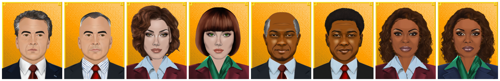
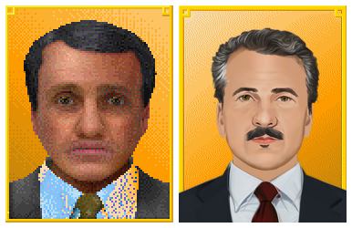

# Manager Faces: Remastered for OpenTTD

Manager Faces: Remastered is a graphics set (NewGRF) for [OpenTTD](https://www.openttd.org), the open source transport simulation game.

Replaces the company manager faces with higher resolution portraits. Artwork is based on an old graphics pack from [AirwaySim](https://www.airwaysim.com), with improvements and a full remaster.

The default OpenTTD face (left) and the same face with `Manager Faces: Remastered` (right):

## Features

* Portraits for all four face styles, made of layers so most parts can still be changed in the face editor.
* Graphics for every zoom level: 32bpp at 1x, 2x and 4x, so the faces stay sharp with any interface size, plus 8bpp graphics for the 8bpp blitter.
* White portraits for face styles 1 and 2, Black portraits for face styles 3 and 4.
* Variations of hair, eyes, chins, noses, lips and outfits, including grey-haired and balding managers.
* All four managers remastered:
  * White man (face style 1): 9 hairstyles including bald, 12 eyes, 12 lips, 4 chins including a beard, and 3 real moustaches.
  * White woman (face style 2): 5 hairstyles, 16 eyes and 10 lips.
  * Black man (face style 3): 5 hairstyles, 11 eyes, 9 lips, 2 chins including a beard, and 3 real moustaches.
  * Black woman (face style 4): 5 hairstyles, 16 eyes, 9 lips, 5 noses and 2 chins.
* Separate jackets, shirts and ties for all masculine faces: 3 jackets, 4 shirts and 6 ties.
* Separate blazers and blouses for all feminine faces: 3 blazers and 4 blouses.
* Working eye colour (brown, blue or green) on face styles 1 and 2.

Face styles 1 and 3 are masculine, face styles 2 and 4 are feminine.

## Limitations

OpenTTD decides which parts the face editor offers, and a NewGRF cannot hide them. Some of them have no graphics in this set:

* Glasses are not supported: "Glasses" does nothing on any face. OpenTTD draws the same glasses graphics on masculine and feminine faces, and the portraits have their eyes in different places, so no glasses would fit both.
* "Earring" does nothing. Both feminine faces already wear stud earrings.
* "Nose" does nothing on face style 2, and on face style 1 values 5 to 8 show the same nose: OpenTTD uses the same nose graphics for both styles, which do not fit both faces. On face style 3, noses 1 and 4 are the same.
* Eye colour works on face styles 1 and 2 only: face styles 3 and 4 have no eye colour option in OpenTTD.

## Installation

Download `Manager Faces: Remastered` from the in-game content download ([BaNaNaS](https://bananas.openttd.org/package/newgrf/4d465201)), or copy `manager-faces.grf` from the [GitHub release](https://github.com/samipuro/openttd-manager-faces/releases/latest) into the `newgrf` folder of your OpenTTD user folder.

Then add it to the NewGRF list of a new game.

If you use another face set as well, place `Manager Faces: Remastered` below it in the list.

Made for OpenTTD 15 and newer.

Questions, feedback and bug reports are welcome in the [tt-forums thread](https://www.tt-forums.net/viewtopic.php?t=92967) or as [GitHub issues](https://github.com/samipuro/openttd-manager-faces/issues).

## Credits

The portraits were originally drawn around 2010 for an early version of [AirwaySim](https://www.airwaysim.com), the online airline management game. AirwaySim no longer uses them and graphics are used here with their permission. This set is a remastered version of that old graphics pack with adjustments for OpenTTD.

## Author

[Sami Puro](https://github.com/samipuro)

## License

Creative Commons Attribution-NonCommercial-ShareAlike 3.0 (CC BY-NC-SA 3.0), see [LICENSE](LICENSE). You may share and modify the set with credit, but not use it commercially, and modified versions must use the same license.

The default face in the comparison image is drawn from the [OpenGFX](https://github.com/OpenTTD/OpenGFX) base graphics, licensed under the GNU General Public License version 2.